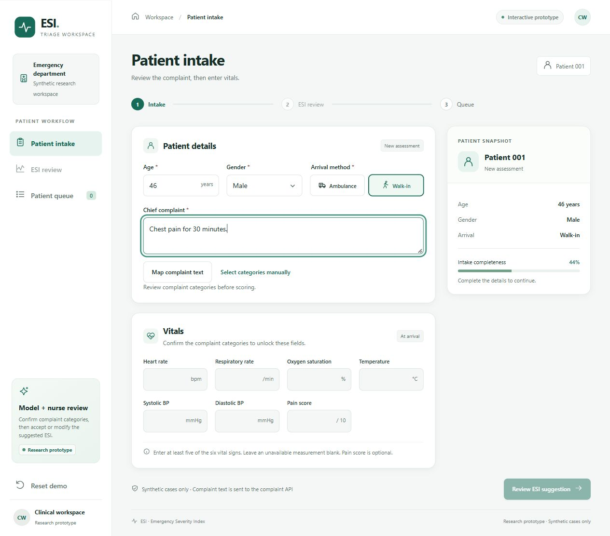

# FirstLine | Emergency triage research prototype

FirstLine suggests an Emergency Severity Index (ESI) level for clinician review using adult emergency department intake data. A clinician checks the complaint categories, reviews or changes the suggested ESI, and adds the case to a queue ordered by the final rating.

[Try the hosted prototype](https://esi-triage-prototype.nawafzwr72.chatgpt.site/) · [Illustrated quick guide](docs/quick-guide.pdf) · [Architecture](docs/architecture.md) · [Data dictionary](docs/data_dictionary.md)

## Model and results

The selected model uses histogram gradient boosting with a shared classifier and complaint-family specialists. ESI 2 examples received twice the training weight. Inputs are age, gender, arrival method, six vital signs, and 200 chief-complaint categories. Eligible visits had a recorded ESI and at least five vitals. Numeric imputation and missingness indicators were fitted on the training portion of each fold.

Evaluation pooled predictions from **384,375 adult visits** across three hospital holdouts. Each hospital was held out once. NHAMCS 2022 was evaluated separately.

| Metric against recorded ESI | Result |
| --- | ---: |
| Exact agreement | 62.27% |
| Within one level | 96.42% |
| Undertriage | 21.66% |
| Overtriage | 16.08% |
| Undertriage by two or more levels | 2.00% |

Within-one agreement counts absolute errors of 0 or 1. Undertriage means predicting a higher ESI number than the recorded level. See the [confusion matrix and per-class results](docs/selected_model_metrics.json) and [22 development comparisons](docs/model_comparisons.csv).

The loaded Python model took **12.44 ms median** and **13.98 ms at the 95th percentile** for 600 single-case predictions across 200 synthetic cases on an Intel Core i7-12700H using one CPU thread. This includes internal preprocessing. Model loading, complaint mapping and network time were outside the measurement.

The evaluation used historical recorded ESI from one health system and was used for model selection. The demo is for fictional cases. The probabilities are uncalibrated, and clinical validation is pending.

## Run the website locally

Install Node.js 24 and run these commands from the repository root.

```sh
cd ui
node scripts/build.mjs
node scripts/preview-cloud.mjs
```

Open `http://127.0.0.1:8778` and choose **Select categories manually**. The local preview uses an in-memory database and runs without an account or API key. The hosted text mapping option uses a server-side Gemini credential. Queue state is held in the browser session.

From `ui/`, run `node checks/test-model-parity.mjs` and `node checks/test-cloud.mjs` to check model parity and the workflow.

## Run the Python model or reproduce training

Use Python 3.12. Install the pinned libraries with `python -m pip install -r requirements.txt`. Open [model_training.ipynb](model/model_training.ipynb) in a Jupyter-capable editor and run its fictional case. The bundled model and supporting modules are sufficient for local inference.

The notebook also contains the cohort selection, three hospital holdouts and final fit. To rerun training, supply an authorized copy of `FinalMlfast.csv` using `FIRSTLINE_TRAIN_CSV`. The notebook verifies the source fingerprint and writes a new model under the ignored `artifacts/` directory.

## Demo screenshots

1. [Enter and map the chief complaint](docs/screenshots/step-1.jpg)
2. [Confirm complaint categories](docs/screenshots/step-2.jpg)
3. [Enter vitals and request the ESI suggestion](docs/screenshots/step-3.jpg)
4. [Review the ESI and add the case](docs/screenshots/step-4.jpg)
5. [Call the patient in](docs/screenshots/step-5.jpg)



## Data provenance

The training export is based on the [Yale ED triage dataset and methods](https://github.com/yaleemmlc/admissionprediction). See the [original study](https://journals.plos.org/plosone/article?id=10.1371/journal.pone.0201016). No visit-level training records are included.
