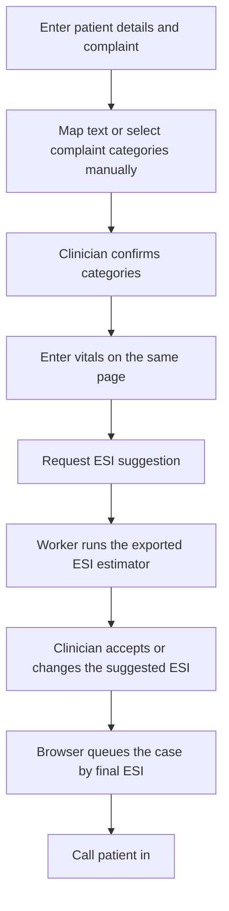

# FirstLine architecture

The optional hosted mapper receives the complaint narrative. Scoring uses confirmed categories and structured intake fields. The model runs inside the Worker. The Python estimator is also included for reproduction. The queue lives in the browser. Review drafts are short-lived and session-bound.
